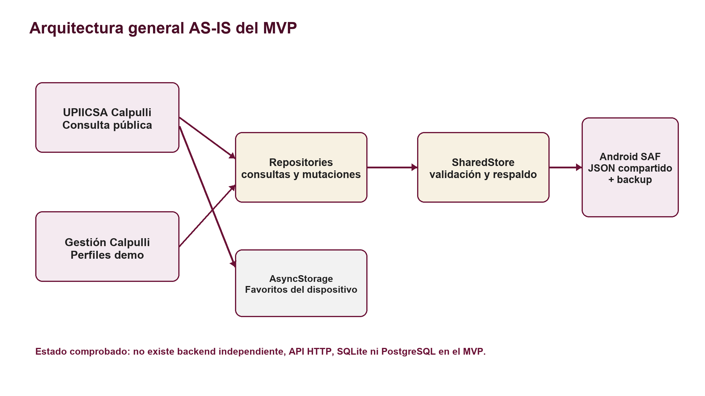

# UPIICSA Calpulli

Plataforma móvil orientada a centralizar información cotidiana de UPIICSA y mantener información esencial disponible incluso bajo conectividad limitada.

> Proyecto académico en desarrollo para la comunidad UPIICSA. No es una aplicación oficial ni implica respaldo institucional formal del IPN o de UPIICSA.

## Estado del proyecto

UPIICSA Calpulli se encuentra en etapa de **MVP académico**. El estado actual, verificado en el código, contiene dos aplicaciones móviles Expo dentro de un monorepo:

- **UPIICSA Calpulli:** aplicación pública de consulta, sin inicio de sesión.
- **Gestión UPIICSA Calpulli:** aplicación de administración y demostración con seis perfiles simulados.

El objetivo inmediato es Android. Ambas aplicaciones pueden leer el mismo estado local mediante Android Storage Access Framework (SAF) y archivos JSON. Los favoritos y la configuración privada de cada aplicación utilizan AsyncStorage.

La validación automatizada histórica no sustituye la prueba manual pendiente en un dispositivo Android. Consulte [Limitaciones conocidas](docs/KNOWN_LIMITATIONS.md).

## Problema que busca atender

La información universitaria se distribuye entre áreas, avisos y canales distintos. El proyecto explora una experiencia móvil unificada para consultar publicaciones, feria de emprendimiento, Marketplace y tutorías, conservando una operación local para la demostración.

## Objetivo

Probar, en un contexto académico, que una aplicación pública y una aplicación de gestión pueden compartir información estructurada en un mismo dispositivo Android sin depender de un backend o conexión a Internet durante el flujo local.

## Funcionalidades actuales

### Aplicación pública

- Inicio con publicaciones institucionales, prioridades y filtros por departamento.
- Historias temporales.
- Feria con estado próximo/activo, mapa de 40 mesas y consulta de asignaciones.
- Marketplace de descubrimiento, sin pagos ni carrito.
- Tutorías con búsqueda y contacto externo.
- Favoritos privados en el dispositivo.
- Temas claro, oscuro y del sistema.
- Refresco al abrir, volver a primer plano o solicitarlo desde la interfaz.

### Aplicación de gestión

- Selector de perfiles demo: superadministrador, administrador de feria, departamento, emprendedor, tutor y moderador.
- Administración de departamentos, publicaciones e historias.
- Configuración de feria, solicitudes y asignación/liberación de mesas.
- Gestión de perfiles, publicaciones y productos de emprendimientos.
- Gestión de tutores y ofertas.
- Moderación posterior de publicaciones.
- Inicialización y restauración explícita de datos ficticios.

## Funcionalidades parciales

- La interoperabilidad, rutas y reglas cuentan con pruebas automatizadas, pero la matriz manual A1–H3 sigue pendiente en Android.
- Existen APK de demostración locales, pero no equivalen a una liberación validada ni se incluyen en la publicación inicial.
- La extensión visual SAES es un producto relacionado y separado; su compatibilidad depende del portal externo.

## Funcionalidades previstas

Estas capacidades pertenecen al **TO-BE** y no están implementadas en el MVP actual:

- backend y sincronización remota;
- autenticación y autorización productivas;
- base de datos central;
- persistencia transaccional y migraciones de producción;
- cartografía institucional completa y rutas de edificios;
- operación multiusuario y multidispositivo.

La tecnología de backend está pendiente de decisión. Los documentos históricos mencionan alternativas incompatibles, entre ellas Node.js y Python/FastAPI; este repositorio no elige una por cuenta propia. SQLite y PostgreSQL también aparecen únicamente como posibilidades futuras.

## Arquitectura AS-IS

El código confirma la siguiente ruta principal:

```text
Pantalla
  ↓
Hook / servicio de aplicación
  ↓
Repository
  ↓
SharedStore
  ↓
Android SAF / almacenamiento local
  ↓
calpulli-state.json + backup + metadatos
```

`packages/domain` contiene los contratos y reglas; `packages/repositories` encapsula consultas y mutaciones; `packages/shared-store` valida, respalda y escribe el estado compartido. La app pública utiliza AsyncStorage para favoritos y ambas apps almacenan de forma privada la URI SAF autorizada.



## Arquitectura objetivo / TO-BE

La documentación académica plantea evolucionar hacia una arquitectura con servicios remotos, seguridad productiva, persistencia central y cartografía institucional. Todo ello se mantiene como **propuesto o pendiente**. No existe actualmente API REST, servidor HTTP, backend independiente, SQLite/PostgreSQL operativos ni sincronización por Internet.

## Tecnologías verificadas

| Tecnología | Tipo | Versión | Estado | Uso |
|---|---|---:|---|---|
| TypeScript | Lenguaje | `~5.9.2` declarado; 5.9.3 resuelto | Implementado | Apps, paquetes y pruebas |
| React | Biblioteca | 19.1.0 | Implementado | Interfaz compartida |
| React Native | Framework móvil | 0.81.5 | Implementado | Aplicaciones móviles |
| Expo | Plataforma/toolchain | 54.0.36 | Implementado | Ejecución y empaquetado de las apps |
| Expo Router | Navegación | 6.0.24 | Implementado | Rutas basadas en archivos |
| npm workspaces | Gestión de monorepo | Según el entorno Node/npm | Implementado | Apps y paquetes compartidos |
| Android SAF | Mecanismo de almacenamiento | API de Android mediante `expo-file-system` 19.0.23 | Implementado | Directorio interoperable elegido por el usuario |
| AsyncStorage | Persistencia privada | 2.2.0 | Implementado | Favoritos y configuración privada |
| JSON | Formato de datos | No aplica | Implementado | Estado compartido, backup y metadatos |
| Manifest V3 | Plataforma de extensión | 3 | Implementado en módulo separado | Extensión visual SAES |

## Estructura del repositorio

```text
/
├── apps/
│   ├── calpulli/
│   └── gestion-calpulli/
├── packages/
│   ├── domain/
│   ├── mock-data/
│   ├── repositories/
│   ├── shared-store/
│   └── ui/
├── docs/
│   ├── audit/
│   └── requirements/
├── documentacion/
├── diagramas/
├── Saes/
├── artifacts/android/
├── CODEX.md
├── REPO_AUDIT.md
├── package.json
└── tsconfig.base.json
```

`Saes/saes-source-snapshot`, los APK y los recursos de identidad se conservan localmente pero se excluyen de la publicación inicial por privacidad, tamaño o permisos pendientes.

## Aplicaciones

| Aplicación | Ruta | Propósito |
|---|---|---|
| UPIICSA Calpulli | [`apps/calpulli`](apps/calpulli/README.md) | Consulta pública del estado compartido y favoritos locales |
| Gestión UPIICSA Calpulli | [`apps/gestion-calpulli`](apps/gestion-calpulli/README.md) | Mutación del estado compartido y demostración por perfiles |

La extensión de navegador de [`Saes`](Saes/README.md) es una línea de trabajo relacionada, no una tercera aplicación Calpulli.

## Requisitos de desarrollo

- Node.js y npm compatibles con el `package-lock.json` existente.
- Android con Expo Go compatible con Expo SDK 54 para la prueba física.
- Dos procesos Metro en puertos distintos para operar ambas experiencias.
- Una carpeta `Documents/UPIICSA_Calpulli_Shared` seleccionada desde ambas apps.

## Instalación

Desde la raíz del repositorio:

```bash
npm install
```

El repositorio contiene un único `package-lock.json` para todos los workspaces. No se ha definido un script de lint ni un script de build en el `package.json` raíz.

## Ejecución

App pública:

```bash
npm run start:calpulli -- --lan --port 8081
```

App de gestión, en otra terminal:

```bash
npm run start:gestion -- --lan --port 8082
```

Scripts adicionales:

```bash
npm run typecheck
npm test
npm run android:calpulli
npm run android:gestion
```

La guía de demostración completa está en [`docs/DEMO_GUIDE.md`](docs/DEMO_GUIDE.md).

## Persistencia local

Ambas apps deben seleccionar el mismo directorio SAF. Gestión inicializa y muta el estado; la app pública lo relee. Los archivos esperados son:

```text
UPIICSA_Calpulli_Shared/
├── calpulli-state.json
├── calpulli-state.backup.json
├── shared-meta.json
└── media/
```

El flujo valida `schemaVersion`, revisión y JSON, conserva un backup y verifica la escritura antes de informar éxito. Los favoritos nunca se escriben en este estado compartido.

## Requerimientos

La consolidación académica identifica **10 requerimientos funcionales (RF)** y **8 requerimientos no funcionales (RNF)**. La trazabilidad está documentada; las prioridades académicas y varias validaciones de dispositivo continúan pendientes.

- [Matriz de requerimientos](docs/requirements/MATRIZ_REQUERIMIENTOS_UPIICSA_CALPULLI.md)
- [Trazabilidad documental](docs/requirements/TRAZABILIDAD_DOCUMENTAL_UPIICSA_CALPULLI.md)

## Documentación

- [Índice de documentación](docs/README.md)
- [Auditoría del repositorio](REPO_AUDIT.md)
- [Documentación consolidada para incorporación](documentacion/00_INDICE.md)
- [Auditoría documental](docs/audit/AUDITORIA_DOCUMENTAL_UPIICSA_CALPULLI.md)
- [Registro de continuidad](docs/audit/README_CONVERSACION.md)
- [Limitaciones conocidas](docs/KNOWN_LIMITATIONS.md)

## Diagramas

Las fuentes Mermaid y sus imágenes renderizadas están en [`diagramas/`](diagramas/README.md). Cada figura se clasifica explícitamente como AS-IS, TO-BE o mixta.

## Limitaciones actuales

Las limitaciones, contradicciones y riesgos se mantienen visibles en [`docs/KNOWN_LIMITATIONS.md`](docs/KNOWN_LIMITATIONS.md). Entre ellas: pruebas manuales Android pendientes, perfiles demo sin autenticación, ausencia de backend y sincronización, cartografía no implementada, tecnología de backend sin decidir y discrepancia histórica de 84 frente a 86 respuestas de cuestionario.

## Roadmap documentado

### MVP actual

- [x] Dos aplicaciones Expo en un monorepo.
- [x] Dominio, repositorios y UI compartidos.
- [x] Persistencia local interoperable mediante SAF/JSON.
- [x] Favoritos privados mediante AsyncStorage.
- [x] Feed, feria, Marketplace, tutorías y gestión por perfiles demo.
- [~] Validación automatizada realizada históricamente; requiere actualización en este checkout.
- [ ] Aceptación manual A1–H3 en Android.
- [ ] Validación de interoperabilidad entre dos APK instalados.

### Evolución pendiente

- [ ] Definir tecnología de backend.
- [ ] Diseñar autenticación, autorización y protección de datos de producción.
- [ ] Definir persistencia central y sincronización remota.
- [ ] Validar cartografía y rutas institucionales.
- [ ] Resolver nomenclatura `Calpulli`/`Calpolli` y permisos de identidad.

## Equipo

Equipo académico **Ctrl + Z**. Para proteger datos personales, esta publicación inicial no incluye boletas, correos ni teléfonos.

## Contexto académico

Proyecto desarrollado en el contexto del Instituto Politécnico Nacional, UPIICSA, Licenciatura en Ciencias de la Informática. Esta referencia describe el marco académico y no constituye aprobación institucional.

## Licencia

Pendiente de definir.
